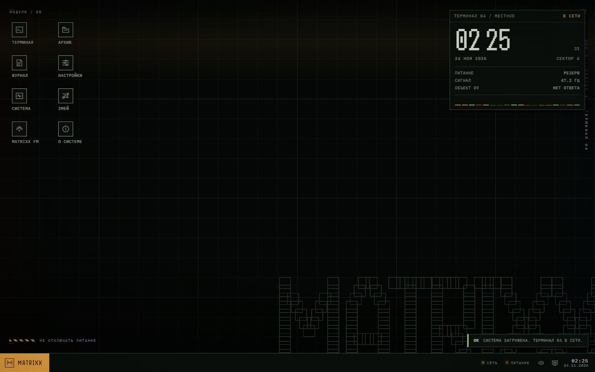
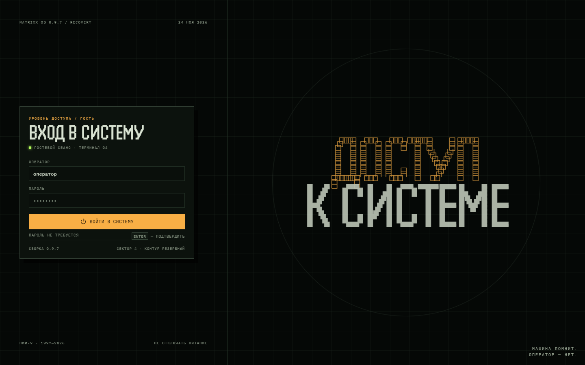
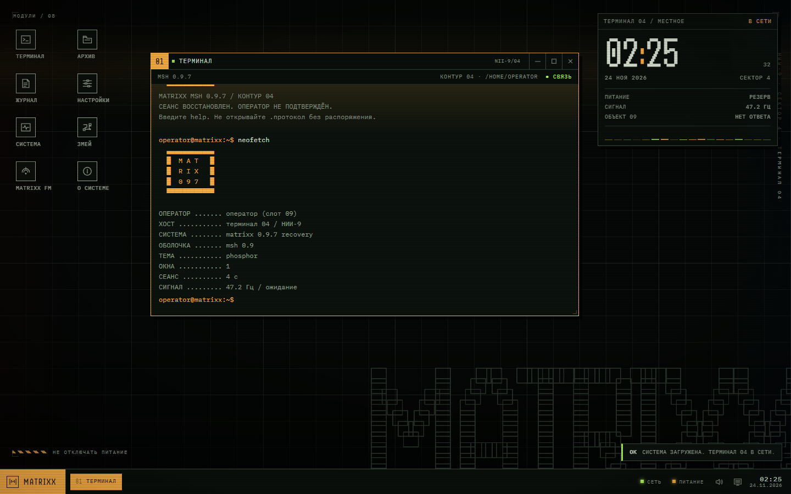
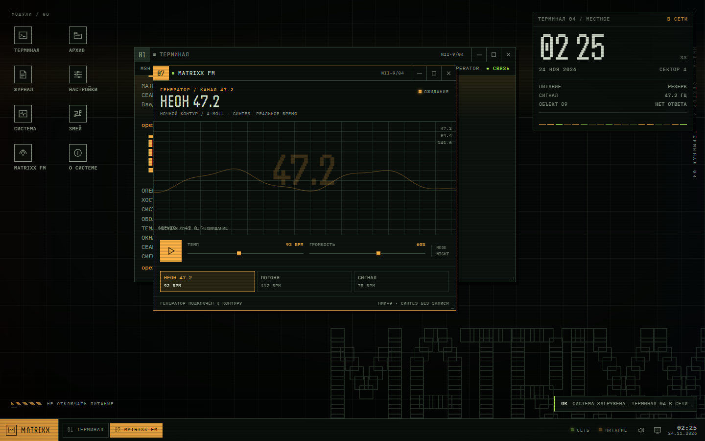
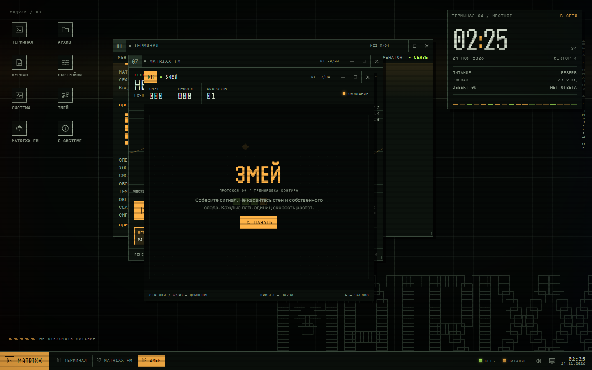
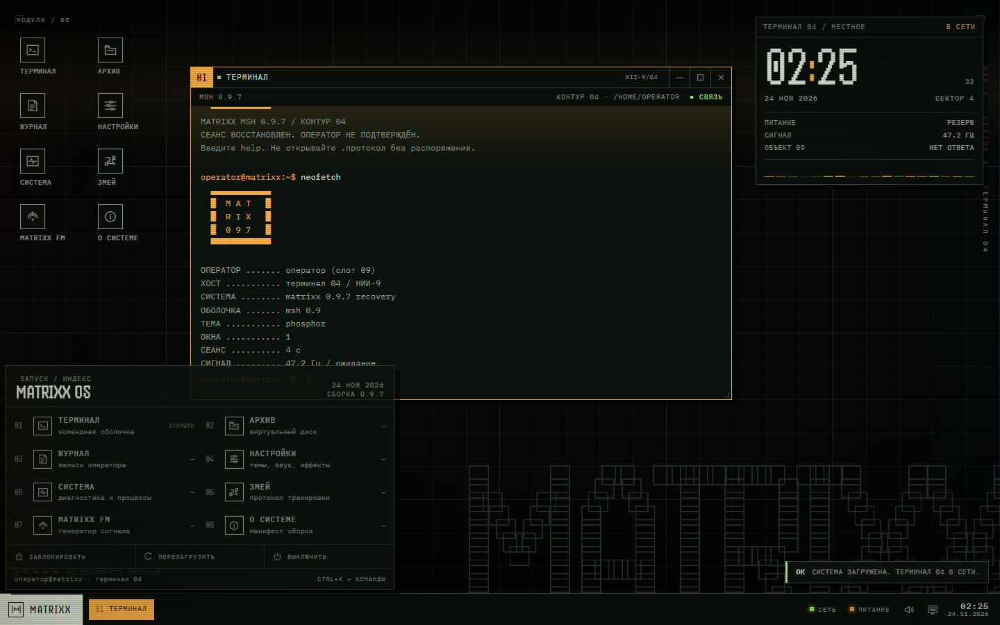
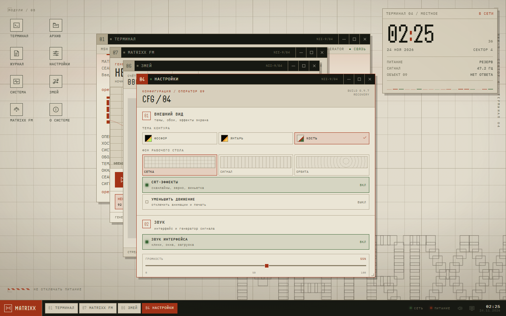
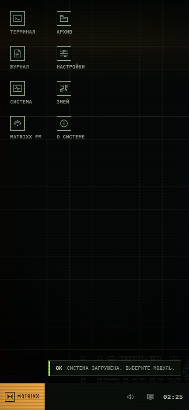
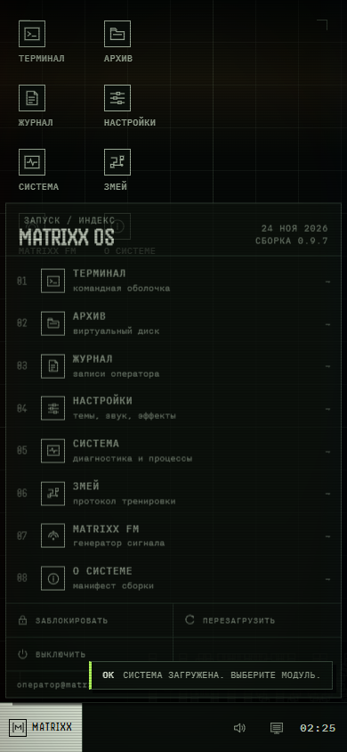

# MATRIXX OS

```
  ▄▄▄▄▄▄▄▄▄▄▄▄
  █  M A T   █
  █  R I X   █
  █  0 9 7   █
  ▀▀▀▀▀▀▀▀▀▀▀▀
  RECOVERY BUILD / НИИ-9 · СЕКТОР 4
```

**Операционная система в браузере.** BIOS, вход, рабочий стол, оконный менеджер,
терминал, архив, журнал, змей, генератор synthwave и сигнал на 47.2 Гц.

Это не лендинг и не один статичный HTML: Vite + React + TypeScript, собственный
оконный менеджер, Web Audio, Canvas и полноценная сборка для GitHub Pages.



## Что внутри

- **BIOS → login → desktop** с анимацией, глитчем и CRT-эффектами.
- **Оконный менеджер**: перетаскивание, resize, фокус, z-order, свернуть/развернуть/закрыть,
  восстановление сессии после перезагрузки.
- **Терминал `msh`**: `help`, `ls`, `cd`, `cat`, `open`, `theme`, `matrix`, `neofetch`, `signal`
  и скрытый файл, который лучше не открывать.
- **Архив**: виртуальная файловая система НИИ-9 с лором, скрытыми файлами и запуском в терминале.
- **Журнал**: заметки с автосохранением в localStorage.
- **Настройки**: три темы (Фосфор / Янтарь / Кость), обои, CRT, звук, reduced motion, сброс.
- **Система**: живые псевдо-метрики, процессы и проверка целостности контура.
- **Змей**: canvas-игра с рекордом и растущей скоростью.
- **MATRIXX FM**: генеративный synthwave на Web Audio, пресеты, BPM, визуализатор.
- **Пасхалки**: Konami-код, `signal`, 5 кликов по логотипу, `.протокол`.

## Стек

- Vite 8, React 19, TypeScript strict
- CSS-переменные, без UI-китов и Tailwind
- Handjet / IBM Plex Mono / Golos Text (self-hosted, кириллица)
- Web Audio API, Canvas 2D
- Vitest

## Запуск

```bash
npm install
npm run dev
```

Открыть `http://localhost:5173`.

## Проверки

```bash
npm run typecheck
npm test
npm run build
npm run preview
npm run smoke
npm run security:check
```

`npm run smoke` прогоняет boot/login, перетаскивание и сворачивание окон, терминал,
скрытый файл архива, темы, автосохранение журнала, змей, запуск/остановку FM,
восстановление сессии и отсутствие горизонтального скролла на 390×844.

## Скриншоты

| | |
| --- | --- |
|  |  |
|  |  |
|  |  |
|  |  |

## Деплой

Подробно — в [docs/DEPLOY.md](docs/DEPLOY.md). Короткий путь:

```bash
git remote add origin https://github.com/<user>/matrixx-os.git
git push -u origin main
npm run deploy
```

Затем в GitHub: **Settings → Pages → Deploy from a branch → gh-pages / (root)**.
Сборка использует относительный `base: './'`, поэтому работает и в подпапке
`username.github.io/matrixx-os/`, и на Cloudflare Pages.

## Управление

| Действие | Клавиши |
| --- | --- |
| Командная палитра | `Ctrl / Cmd + K` |
| Переключение окон | `Alt + \`` |
| Закрыть оверлей | `Esc` |
| Терминал | `↑` / `↓` история, `Tab` автодополнение |
| Змей | стрелки / `WASD`, `Space` пауза, `R` заново |

## Генерация скриншотов

Скрипт использует установленный Edge или Chrome, без скачивания браузеров:

```bash
npm run preview
npm run shots
```

Результат — в `screenshots/`.

## Структура

```
src/
  os/           оболочка: boot, login, WM, taskbar, palette, звук
  apps/         terminal, files, notes, settings, system, snake, fm, about
  data/         виртуальная файловая система и лор
  styles/       токены, база, оболочка, окна
scripts/        скриншоты и smoke-проверка
```

## Лор

НИИ-9, сектор 4, 1997. После аварии на объекте 09 терминал остался включённым.
Система помнит сеанс, которого не было в журнале. Файл `.протокол` существует.
Сигнал 47.2 Гц существует. Не отвечайте на сигнал.
