# Matrixx Linux 24.04 LTS

**A complete Linux desktop in your browser.** GRUB and systemd boot, GDM sign-in,
a GNOME-style shell with Activities, quick settings, a dock, tiling-free windows,
and eight working applications — all running on Vite, React and TypeScript.

**Live:** https://yakutc.github.io/matrixx-os/ · **Repo:** https://github.com/Yakutc/matrixx-os

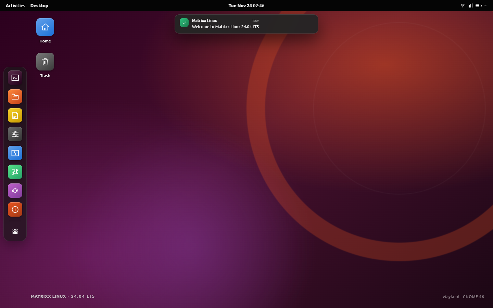

Matrixx Linux is a fictional distribution inspired by Ubuntu, GNOME and Yaru. It is
not affiliated with Canonical or the GNOME Project. Everything is local: no backend,
no API keys, no external runtime requests.

## What is inside

- **Boot:** GRUB menu → systemd log → GDM login → GNOME-style session.
- **Shell:** top bar with Activities and system menu, left dock with running
  indicators, Activities overview with live window cards, application grid, search,
  quick settings, notifications, lock screen and power-off flow.
- **Window manager:** drag, resize, focus/z-order, minimize, maximize, restore,
  keyboard snapping (`Super + ←/→/↑/↓`), session restore.
- **Terminal:** `help`, `ls -la`, `cd`, `cat`, `open`, `theme`, `wallpaper`,
  `fastfetch`, `cmatrix`, `signal`, `apt`, `sudo`, history, tab completion and a
  hidden `.protocol` file.
- **Files:** Nautilus-style places sidebar, expandable file tree, hidden files,
  file preview, open-in-terminal.
- **Text Editor:** documents, search, autosave, delete, flush-on-close.
- **Settings:** Appearance, Sound, System and About pages; Dark / Light / High
  Contrast styles; three wallpapers; Night Light; animations toggle; reset.
- **System Monitor:** CPU graph, memory, temperature, process list and a file-system
  integrity check that discovers something it should not.
- **Snake:** canvas game with score, best score and increasing speed.
- **Music:** generative synthwave on Web Audio with three presets, tempo, volume and
  a live spectrum visualiser. No audio files.
- **About:** distribution details, links and a small secret if you click the logo.

## Stack

- Vite 8, React 19, TypeScript strict
- Hand-written CSS with Yaru-inspired design tokens (no UI kit, no Tailwind)
- Ubuntu and Ubuntu Mono fonts, self-hosted via Fontsource
- Web Audio API, Canvas 2D
- Vitest

## Run it

```bash
npm install
npm run dev
```

Open `http://localhost:5173`.

## Checks

```bash
npm run typecheck
npm test
npm run build
npm run preview
npm run smoke
npm run security:check
```

`smoke` exercises GRUB/GDM, dock, window drag/minimize/restore, Activities, quick
settings, terminal, files, settings, editor autosave, snake, music, session restore
and the 390×844 mobile layout. `security:check` covers null localStorage, unmount
flushing, prototype aliases and CSP.

## Screenshots

| | |
| --- | --- |
| 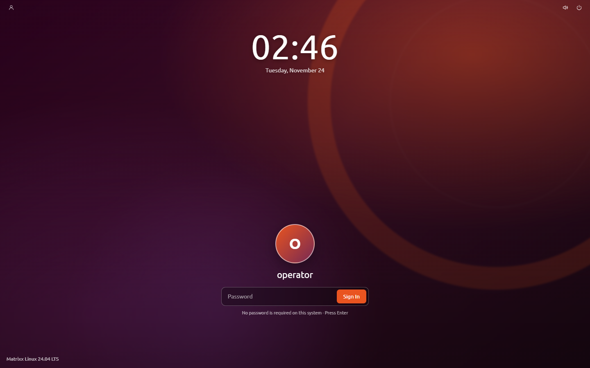 | 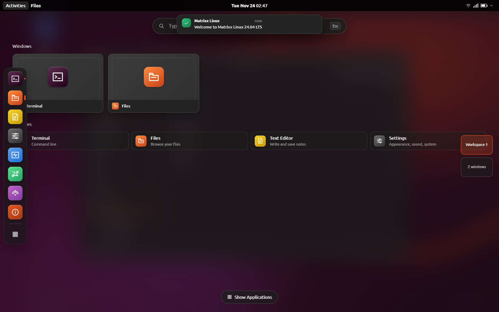 |
| 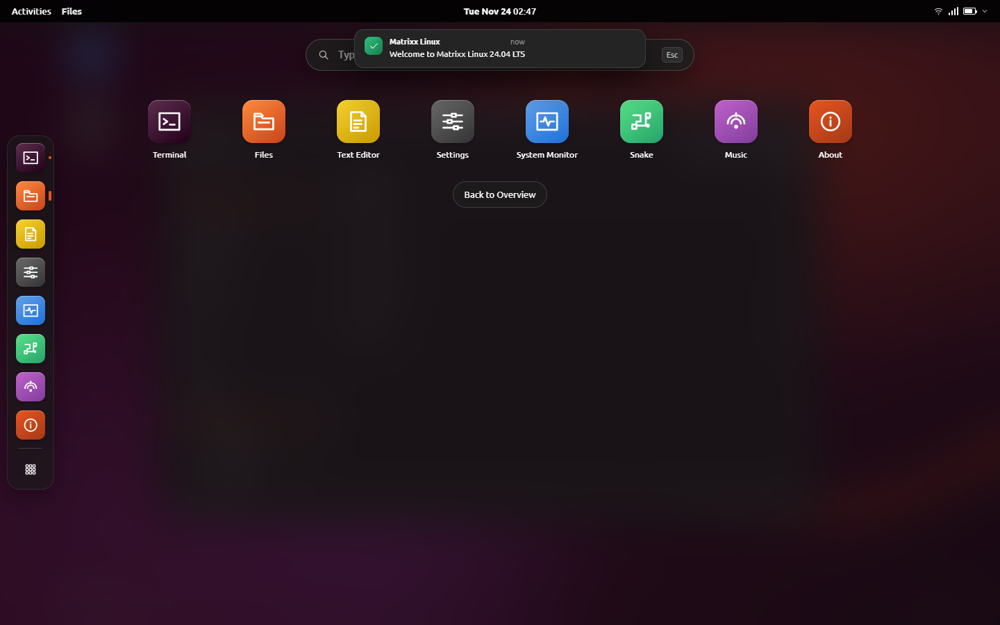 | 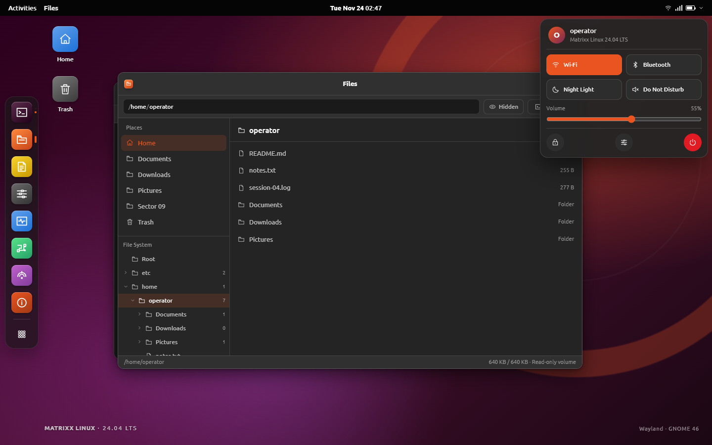 |
| 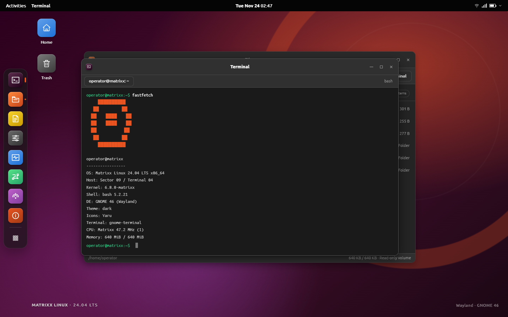 | 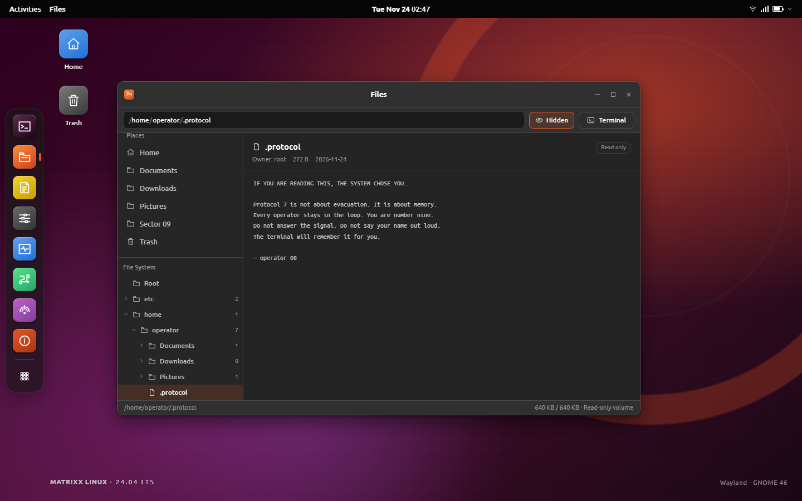 |
| 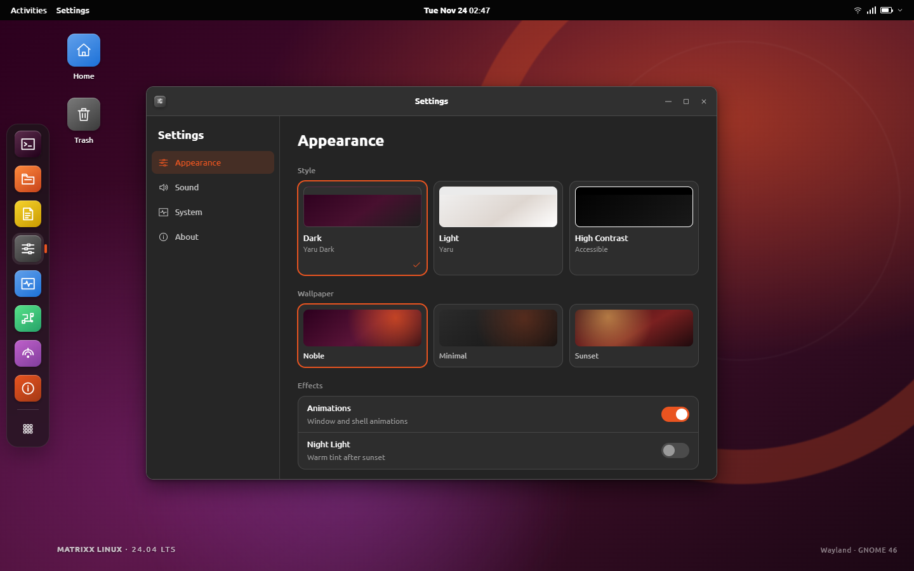 | 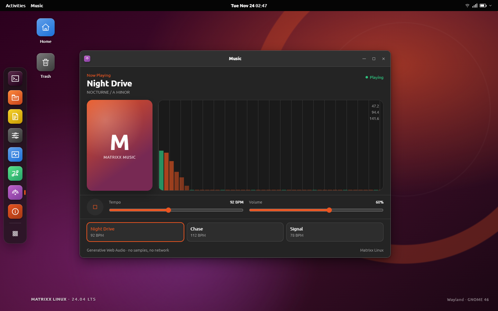 |
| 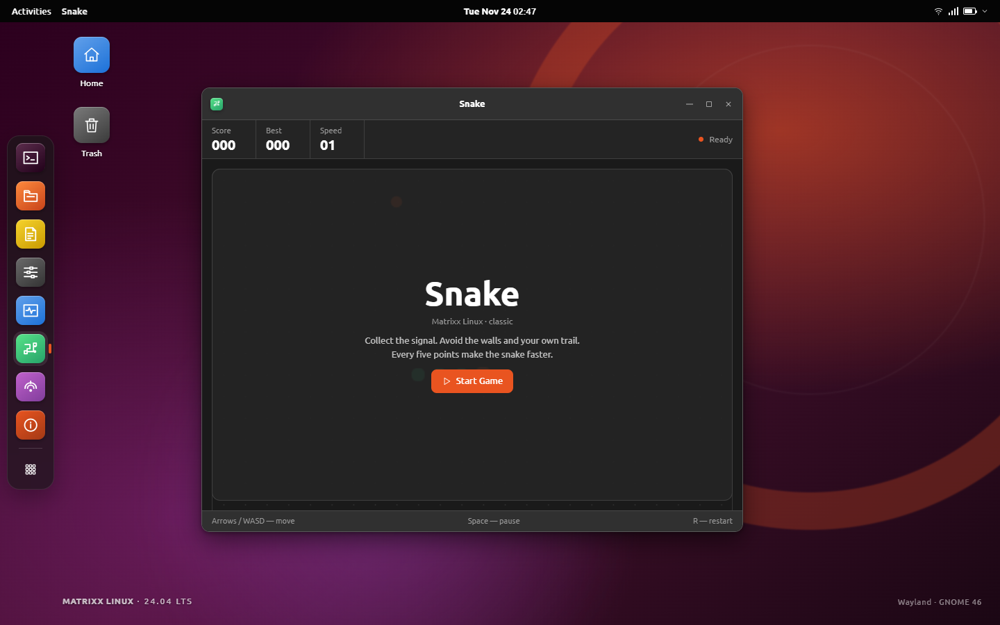 | 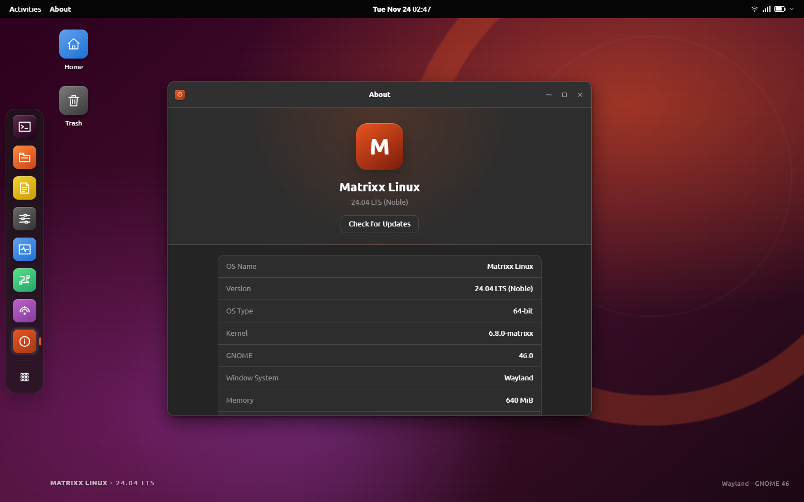 |

Mobile 390×844:

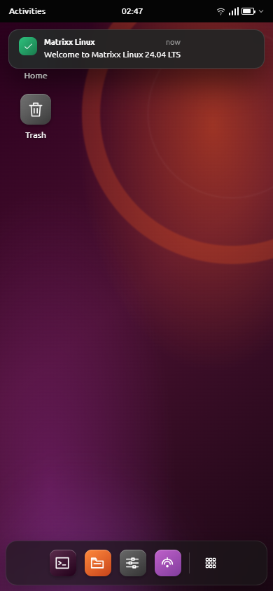

## Keyboard and gestures

| Action | Shortcut |
| --- | --- |
| Activities / search | `Super`, or click **Activities** |
| Application grid | `Super + A` |
| Open favorite app | `Super + 1…8` |
| Snap window left / right | `Super + ← / →` |
| Maximize / restore | `Super + ↑ / ↓`, double-click title bar |
| Close window | `Alt + F4` |
| Show desktop | `Super + D` |
| Quick shell search | `Ctrl / Cmd + K` |
| Close overlay | `Esc` |

## Deploy

See [docs/DEPLOY.md](docs/DEPLOY.md). Short version:

```bash
npm run build
npm run deploy
```

Then enable **Settings → Pages → Deploy from a branch → gh-pages / (root)**.
The build uses relative `base: './'`, so it works from a GitHub Pages subpath or
Cloudflare Pages without changes.

## Structure

```
src/
  os/        GRUB/GDM, shell, top bar, dock, activities, quick settings, windows
  apps/      Terminal, Files, Text Editor, Settings, System Monitor, Snake, Music, About
  data/      virtual Linux file system and lore
  styles/    tokens, base, shell, windows
scripts/     smoke, screenshots, security regression
docs/        deployment and design notes
```

## License

MIT. See [LICENSE](LICENSE).
